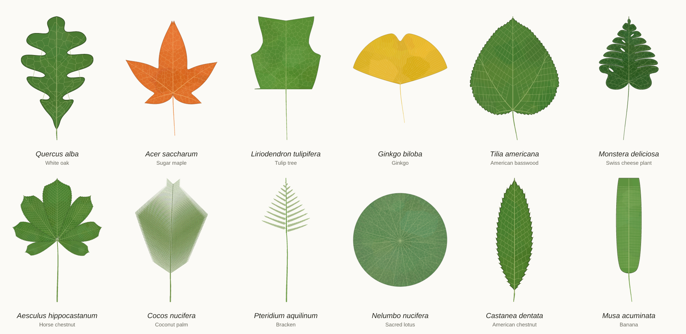
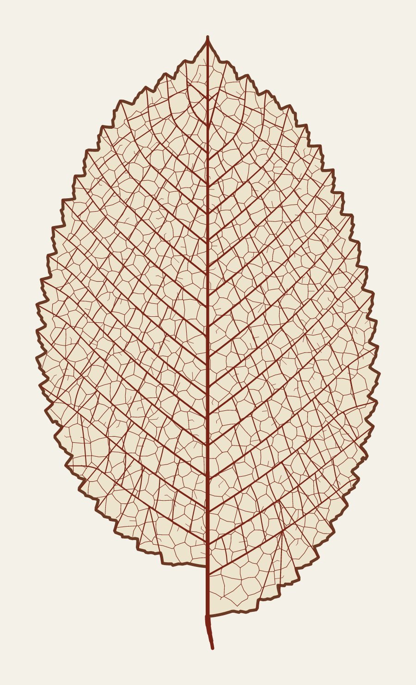
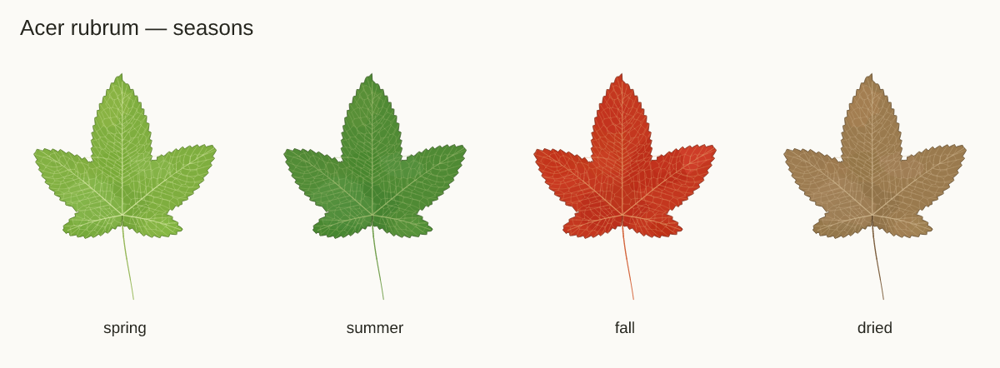
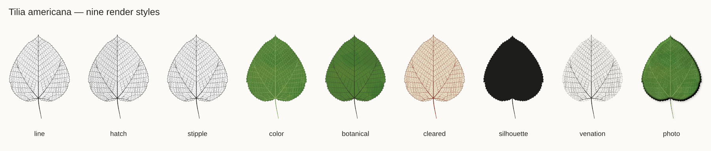
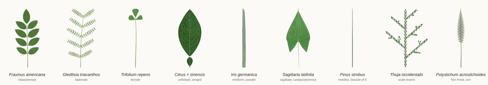
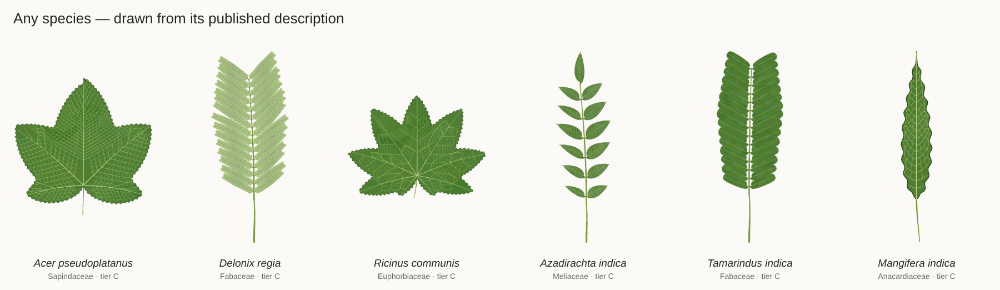

# leafdraw

Botanically accurate procedural leaf drawings. Inspired by [fishdraw](https://github.com/LingDong-/fishdraw): seeded, deterministic, polyline output, plotter-ready. Leaves are built from botanical terms, and every term has a numeric definition, so a drawing can be checked against what the term means.



<table>
<tr>
<td width="34%"><br><sub>Slow drawing: outline → primaries → secondaries → minor veins (animated SVG)</sub></td>
<td width="33%"><br><sub>Venation: craspedodromous elm, cleared-leaf style, all vein orders</sub></td>
<td width="33%"><br><sub>Seasons (CIELAB palettes)</sub></td>
</tr>
</table>





**Any species, from its published description only** — no curated data; GBIF + POWO + Wikipedia text → traits → family template → constraints:



<sub>Every image is a live render of this repo (`node tools/gallery.mjs`), fixed seeds.</sub>

**Use online:** https://kalairajah-personal.github.io/leafdraw/ — the studio; type any plant name. No install.

**Install:** `git clone https://github.com/kalairajah-personal/leafdraw && cd leafdraw && npm install` → `node cli/leafdraw.js -s "Quercus alba" -o oak.svg`. Or one file: `dist/leafdraw.js` (browser global `leafdraw`) / `dist/leafdraw.mjs` (ES module).

Single rolling document for the project. Update this file; don't add new docs.

---

## 1. Quick start

```bash
npm install                      # esbuild (+ @resvg/resvg-js for PNG)
node species/build-species.mjs   # catalog → species/*.json + data/species.json
node build.js                    # dist/leafdraw.js, dist/leafdraw.mjs, dist/leafdraw-studio.html, data/traits.json
npm test                         # 9 core tests

node cli/leafdraw.js -s "red maple" --seed 7 --style color --season fall --labels -o maple.png
node cli/leafdraw.js -t "ovate, doubly serrate, acuminate, cordate" --seed 3 --style hatch -o leaf.svg
node cli/leafdraw.js -s quercus-alba --plate 6 --style botanical -o oaks.png
node cli/leafdraw.js -s ginkgo-biloba -f anim --order growth -o ginkgo.svg
node cli/leafdraw.js -s acer-palmatum -f gcode --page A4 -o maple.gcode
node cli/leafdraw.js --list maple | --terms margin | --validate "linear, palmatifid"
```

Library:

```js
import { draw, renderSVG, registerSpecies } from './core/index.js';
registerSpecies(species);                       // data/species.json
const scene = draw('Acer rubrum', 7);            // or {traits, params} or "ovate, serrate, …"
const svg = renderSVG(scene, { style: 'botanical', season: 'fall', labels: true });
```

Browser: `dist/leafdraw.js` (global `leafdraw`, species pre-registered). Studio: `dist/leafdraw-studio.html` (one file, works offline).

---

## 2. Architecture

```
core/        JS, zero runtime deps. draw(spec, seed, opts) → Scene (pure, no I/O)
  traits.js        vocabulary + numeric definitions (glossary + MLA)
  constraints.js   validity matrix: errors / warnings / implied fixes
  resolve.js       spec → concrete config (seeded sampling of mean ± sd)
  engines/blade.js width-profile blades, apex/base shaping, pinnate lobes, lobed bases
  engines/polar.js palmate lobes, pedate, flabellate, peltate
  margin.js        tooth profiles along the margin
  venation.js      primaries, secondaries, tertiaries, areoles (MLA categories)
  compound.js      compound leaves + fern fronds (recursive)
  shoot.js         phyllotaxis on a stem, occlusion, scale-leaf branchlets
  holes.js fold.js fenestrate/perforate; folding and 3-D forms (2.5-D)
  measure.js       morphometrics (same metrics as the Python pipeline)
  render/          svg.js · animate.js · plotter.js (G-code, HPGL)
cli/         leafdraw command
web/         studio page (built into dist/leafdraw-studio.html)
species/     one JSON per species (+ build-species.mjs, the curated source)
pipeline/    Python data factory: GBIF → segment → measure → fit → species JSON
data/        species.json, traits.json (shared with the pipeline)
tests/       node --test
```

Boundaries: core never does I/O. Pipeline never renders for users; it emits species JSON and validation scores. CLI and studio are thin shells.

**Scene** = tagged polylines (`outline, petiole, rachis, v1…v5, spine, hair, awn, cirrus, fold, shade, stomata, sorus, hole`) + fills (rings with holes, hatch region) + meta. Units mm, y up. Same seed → same scene on every platform.

---

## 3. Trait model

18 categories. Each term carries numbers, not just a name.

| Category | Terms |
|---|---|
| plantGroup | dicot, monocot, conifer-needle, conifer-scale, ginkgo, fern |
| structure | simple, unifoliate, bifoliolate, bigeminate, ternate, biternate, palmately-compound, paripinnate, imparipinnate, bipinnate, tripinnate |
| shape | acicular, filiform, subulate, linear, ensiform, lorate, lanceolate, oblanceolate, elliptic, oblong, ovate, obovate, orbicular, reniform, cordate, obcordate, deltoid, rhomboid, trullate, obtrullate, spatulate, cuneiform, falcate, pandurate, hastate, sagittate, flabellate, palmate |
| lobation | none, lobed, pinnately-lobed, pinnatifid, pinnatipartite, pinnatisect, lyrate, laciniate, multifid, palmately-lobed, palmatifid, palmatipartite, palmatisect, pedate |
| apex | acute, subobtuse, obtuse, rounded, truncate, acuminate, caudate, cuspidate, mucronate, apiculate, aristate, emarginate, retuse, subulate, cirrate, ecirrate |
| base | acute, cuneate, subobtuse, obtuse, rounded, truncate, attenuate, cordate, auriculate, sagittate, hastate, oblique |
| margin (+ modifiers) | entire, serrate, serrulate, doubly-serrate, dentate, denticulate, crenate, crenulate, sinuate, undulate, lobate, spiny, ciliate, crisped |
| symmetry · attachment · surface | symmetrical, asymmetrical · petiolate, sessile, peltate, perfoliate · laminar, fenestrate, perforate |
| form3d · folding | flat, terete, semiterete, undulate · carinate, conduplicate, reduplicate, cucullate, involute, revolute, plicate, supervolute |
| primary venation | pinnate, actinodromous, palinactinodromous, acrodromous, campylodromous, parallel, flabellate, dichotomous |
| secondary | craspedodromous, semicraspedodromous, brochidodromous, festooned-brochidodromous, eucamptodromous, cladodromous, reticulodromous, parallelodromous |
| tertiary · areoles · marginal | opposite/alternate/mixed percurrent, reticulate, ramified, transverse · well-developed, moderate, poor · fimbrial, intramarginal |
| phyllotaxis | alternate, distichous, opposite, decussate, whorled, rosulate, fascicled |

Numeric definitions (examples). Full set in `core/traits.js` / `data/traits.json`.

| Term | Definition used |
|---|---|
| lanceolate | L:W 3–6, widest 30–40% from base |
| obovate | L:W 1.3–2, widest 60–70% |
| pinnatifid / -partite / -sect | sinus depth 28–48% / 55–85% / 88–96% of the way to the midrib |
| acute / obtuse apex | apex angle 50–80° / 105–150° |
| acuminate | concave tip over 8–16% of L |
| serrate | teeth every 2.5–4.5% L, height 0.7–1.4% L, asymmetric, leaning toward the apex or lobe tip |
| crenate | rounded teeth, acute sinuses |
| craspedodromous | each secondary ends in a tooth or lobe tip; unserved teeth get abmedial branches |

**Constraint matrix** (`core/constraints.js`, 33 rules). Examples: needle blades can't be lobed; palmate lobing requires radiating primaries; craspedodromous needs teeth or lobes; peltate needs actinodromous; parallel primaries imply parallelodromous + transverse; obcordate implies emarginate; reniform implies cordate base. Levels: error (blocked), warn (rare), fix (applied automatically).

### Glossary coverage

Every term in Wikipedia's *Glossary of leaf morphology* resolves to a vocabulary term (test 3), and every vocabulary term renders (test 4).

| Glossary category | Status | How |
|---|---|---|
| Structure (11 + aliases) | ✅ | recursive compound engine |
| Whole shape, symmetric profiles | ✅ | width-profile engine |
| Basal lobes (cordate, reniform, hastate, sagittate, auriculate) | ✅ | extended profile + sinus cut; explicit pointed lobes |
| Lobing depth terms | ✅ | explicit sinus/lobe-tip construction (pinnate), smooth-max of lobes (palmate) |
| Needle / thread / awn | ✅ | blade engine at extreme aspect + stomatal lines; fascicles in shoot view |
| Peltate / perfoliate | ✅ | polar engine centre attachment; stem drawn through blade |
| Apex, base, margin | ✅ | apex/base modules, tooth module, spines, hairs, awns, cirrus |
| Fenestrate / perforate | ✅ | holes cut from blade and veins |
| Folding / 3-D (carinate … supervolute, terete) | ✅ 2.5-D | illustrator conventions: fold lines, rolled-margin bands, keel, pleat and cylinder shading |
| Venation (not in glossary) | ✅ | MLA categories, section 4 |
| Phyllotaxis (not in glossary) | ✅ | shoot view |

---

## 4. Venation

1. **Primaries.** Pinnate midrib; actinodromous rays to lobe tips (basal or suprabasal); palinactinodromous forks; acrodromous/campylodromous arcs at fixed fractions of the local half-width; parallel veins converging to the apex; Ginkgo-type dichotomous growth (veins fork whenever spacing exceeds ~2× target).
2. **Secondaries.** Marched from the parent with an angle that changes base→apex and bends toward an asymptotic angle. Stop rule by type: reach a tooth (crasped.), loop into the next secondary (brochido., festooned), fade along the margin (eucampto.), fork (clado.), dissolve into reticulum (reticulo.). Lobed blades: one secondary per lobe tip, routed inside the blade.
3. **Tertiaries.** Percurrent links between neighbouring secondaries (opposite, alternate, mixed), Voronoi reticulum, or colonisation-grown ramified veins; transverse cross-veins for parallel venation.
4. **Areoles.** Voronoi cells around Poisson-spaced centres with freely ending veinlets; spacing set by the areole term.

A rasterised distance field gives fast inside tests and margin distance for all of this.

---

## 5. Rendering

| Style | Use |
|---|---|
| line | ink line art, plotter-ready |
| hatch / stipple | shading on one half, clipped analytically (plottable) |
| color / botanical | blade fill with mottling, vein colour, season palettes (spring, summer, fall, pressed); botanical adds ink lines |
| cleared | stained cleared-leaf look |
| venation / silhouette | veins only / solid shape (silhouette is also the pipeline's round-trip input) |

Options: labels with binomial, family, seed and scale bar; true-size mm output; plates of N seeds; shoot view.

**Slow drawing** (`renderAnimatedSVG`): pen orders `illustrator` (outline → axes → v1 → v2 → v3 → areoles → fill), `growth` (petiole → veins → outline), `plotter` (nearest-neighbour). Duration configurable.

**Plotter**: G-code and HPGL, fitted to A5/A4/A3/custom or true size, nearest-neighbour path order.

---

## 6. Studio (web)

`dist/leafdraw-studio.html`, also published as the *Leafdraw Studio* artifact. Species search, **any-species lookup** (type any plant name or common name; GBIF autocomplete), or trait builder with live validation; seed; leaf / on stem / plate of 6; 9 styles (incl. photo); 4 seasons; detail level; slow drawing; export SVG, PNG, G-code, HPGL, scene JSON, spec JSON.

---

## 7. Species catalog

**Any species.** Names not in the catalog resolve live (tier C):

1. **Taxonomy** — GBIF backbone match (scientific or common name; synonyms → accepted name; family, genus, class).
2. **Description** — leaf sentences from POWO (Kew; Flora Zambesiaca, FTEA, Flora of Iraq …) and Wikipedia.
3. **Text → traits** (`core/text.js`) — glossary terms + plain-English phrases ("heart-shaped", "toothed"), alternatives ("ovate to cordate"), qualifiers ("rarely toothed" ignored), clause filtering (flowers, fruits, buds, cultivars, juvenile leaves dropped), sizes in mm/cm/m/in/ft owned by a leaf word, leaflet vs leaf sizes, leaflet counts.
4. **Gaps** — genus template (`core/families.js`, 45 genera) > family template (≈120 families) > class default.
5. **Constraint check** — text terms that contradict the matrix are dropped, not drawn. Evidence and the source of every trait (`auto.from`) ship with the spec.

```bash
leafdraw -s "Mangifera indica" --style color -o mango.svg     # resolves, caches species/auto/mangifera-indica.json
leafdraw --resolve "neem"                                       # common name → Azadirachta indica; prints spec + evidence
```

Studio: same path in the browser. If the page cannot reach GBIF/POWO, it asks Claude for a flora-style description (viewer consents; marked "unverified") and runs it through the same extractor and constraints.

**Curated catalog.** 62 species in `species/`, tier B, each checked against Wikipedia + POWO text (section 9).

| Group | Count | Species |
|---|---|---|
| Dicot simple | 36 | elm, beech, birch, chestnut, cottonwood, basswood, tulip tree, white oak, red oak, wild radish, dandelion, yarrow, magnolia, black cherry, weeping willow, dogwood, blue gum, camphor, holly, lamb's quarters, daisy, man-of-the-earth, sheep sorrel, rosemary, redbud, wild ginger, red/sugar/Japanese maple, sweetgum, sycamore, ivy, lotus, nasturtium, hellebore, orchid tree |
| Monocot | 9 | monstera, maize, iris, clivia, banana, arrowhead, false hellebore, bellwort, chives |
| Gymnosperm | 3 | ginkgo, white pine, arborvitae |
| Compound | 10 | white ash, black walnut, honey locust, silk tree, horse chestnut, white clover, woodsorrel, poison ivy, orange, West Indian locust |
| Fern | 3 | Christmas fern, lady fern, bracken |

**Tiers.** A = fitted from measured specimens. B = literature-curated, validated against published descriptions. C = any species, auto-built from its published description + family/genus template. Stored per species, shown on the label.

**Species spec format**

```json
{ "id": "quercus-alba", "name": "Quercus alba", "common": ["White oak"], "family": "Fagaceae", "tier": "B",
  "traits": { "shape": "obovate", "lobation": "pinnatipartite", "apex": "rounded", "base": "cuneate", "margin": "entire",
              "secondary": "craspedodromous", "tertiary": "reticulate", "phyllotaxis": "alternate" },
  "params": { "length": [150, 20], "aspect": [1.9, 0.15], "widest": [0.62, 0.03], "lobeCount": [4, 0.4], "lobeDepth": [0.62, 0.08] },
  "palette": { "summer": { "blade": "#4a7a32" }, "fall": { "blade": "#8e3d1f" } } }
```

Params are `[mean, sd]` (sampled per seed, clamped to ±2 sd) or numbers. Compound species add `compound: {pairs, leaflets, pinnaPairs, petiolule, angle, leaflet: {traits, params}}`.

---

## 8. Pipeline (Python) — path to every species

```bash
cd pipeline
python -m leafdraw_pipeline.cli fetch "Quercus alba" --n 40 --out work/qa     # GBIF specimens, open licences only
python -m leafdraw_pipeline.cli measure work/qa --mm-per-px 0.1                # segment + measure
python -m leafdraw_pipeline.cli fit work/qa --name "Quercus alba"              # → species/quercus-alba.json (tier A)
python -m leafdraw_pipeline.cli text "Ulmus rubra" description.txt [--llm]     # → tier B-text spec
python -m leafdraw_pipeline.cli roundtrip quercus-alba magnolia-grandiflora    # render → measure → compare
python -m leafdraw_pipeline.cli identify leaf.png                              # Pl@ntNet (PLANTNET_API_KEY)
python -m leafdraw_pipeline.cli score --seeds 3 --out score.json               # botanist score, whole catalog
# or on GitHub: Actions → plantnet-score → Run (repo secret PLANTNET_API_KEY)
python -m unittest discover -s tests
```

| Module | Job |
|---|---|
| gbif.py | backbone name match, specimen images with licence + occurrence provenance |
| segment.py | Leafsnap-style HSV segmentation, petiole removal; LeafMachine2 adapter (`LEAFMACHINE2_DIR`) for herbarium sheets |
| measure.py | length, width, aspect, widest point, apex/base angles, teeth, tooth height, lobe depth, circularity, elliptic Fourier descriptors |
| fit.py | measurements → params (mean, sd) + trait terms via the same numeric definitions (`data/traits.json`) |
| palette.py | CIELAB k-means palettes from field photos |
| text_traits.py | older Python text extractor; the canonical one is `core/text.js` (`leafdraw --resolve`) |
| validate.py | round-trip check; Pl@ntNet "botanist score" (top-1 / top-5 identification of rendered leaves) |

Scale plan: any species already resolves to tier C on demand. Tier A needs `fetch → measure → fit` per species on a machine with network (the user's Mac; the cloud workspace has no route to GBIF). Validation tools:

```bash
node tools/validate-lit.mjs       # curated species vs Wikipedia/POWO text  → data/validation/report.json
node tools/validate-holdout.mjs -v # unseen species: Wikipedia vs POWO agreement → data/validation/holdout-report.json
```
Source text for both was fetched live (GBIF, Wikipedia, POWO) and is stored in `data/validation/*-sources.json`.

---

## 9. Accuracy checks

| Check | Where | Result |
|---|---|---|
| Determinism | tests/core.test.js | pass |
| Every catalog species draws; ≥97% of vein points inside blade (≥92% deep-lobed) | core test 2 | pass |
| Every glossary term in vocabulary; every term renders | tests 3–4 | pass |
| Constraint matrix blocks impossible combos | test 5 | pass |
| Shape terms hit their aspect and widest-point ranges; serrate vs entire teeth; acute apex < 95°; lobe depth per lobing term | test 6 | pass |
| Craspedodromous secondaries reach the margin (>80%) | test 7 | pass |
| All styles, animation, G-code, HPGL, plates | test 8 | pass |
| Pipeline round-trip (render → segment → measure): aspect within 15%, widest point within 0.12; text extraction; shape classification | pipeline/tests | pass |
| Text extractor: alternatives, qualifiers, units, leaf-owned sizes, leaflet sizes | tests/auto.test.js | pass |
| Every family + genus template (≈165) gives a valid, drawable spec | auto test 2 | pass |
| Auto specs from real Wikipedia/POWO text for all 62 species valid + drawable; resolver with mocked APIs | auto tests 3–4 | pass |
| **Curated vs literature** (62 species; Wikipedia + POWO text, fetched 2026-10-19) | tools/validate-lit.mjs | taxonomy: 62/62 family = GBIF; GBIF accepts 61/62 names (*Citrus × sinensis* is a synonym there); POWO's first search hit is flagged non-accepted for 5 (dandelion, camphor → *Camphora officinarum*, Japanese maple, false hellebore, orange) — name-level only, no drawing impact. Traits: 105 compared → 72 agree, 29 near-synonym, 4 differ. Leaf length 37/37 within the text range; aspect 16/16 |
| **Holdout: any-species path** (164 unseen species, 58 families, top GBIF species worldwide + IN, BR, ID, ZA, AU, CN, MX, NG, JP) | tools/validate-holdout.mjs | 164/164 valid + drawable. Wikipedia vs POWO (independent sources, 45 species with both): first run 36 traits → 27 agree, 4 near, 5 differ; leaf length 8/8 overlap. After fixing 3 extractor bugs it exposed: 27 → 21 / 5 / 1. 96/164 species got ≥1 trait from their own text; the rest came from genus (20) / family (111) / class (33) templates |

**The 4 trait differences** are real variation, kept as drawn: wild radish (terminal lobe undulate vs. dentate stem leaves), lamb's quarters (lower leaves sometimes 3-lobed), sheep sorrel (basal rosette as well as stem leaves), large-flowered bellwort (Wikipedia "obovate" vs. flora "ovate–elliptic").

**Fixed after validation:** banana length 1.5 → 2.2 m; American chestnut aspect 4.2 → 3.6; man-of-the-earth shape pandurate → cordate; orchid tree length 10 → 15 cm.

**Caveat.** The extractor was tuned on the same 62 texts it scores; its first holdout run (above) is the unbiased number. The one remaining holdout difference is real: *Plantago major* apex "acute" (Wikipedia) vs "rounded" (Flora of Tropical East Africa).

**Visual spot check.** Auto specs with no curated data drawn for sycamore maple, flame tree (bipinnate, 17 pinna pairs × 23 leaflet pairs from text), castor (9 lobes from text), neem, tamarind, mango, horse chestnut, coconut, black walnut, monstera, white oak: all recognisable.

---

## 10. Limits

- Catalog values are literature-curated (tier B), not yet fitted from specimens. Recognisable, not specimen-exact.
- Tier C (any species) is only as good as the published description: when a description is silent, the family template decides, so two species of one family may look alike.
- No image-based check yet: GBIF has herbarium images for all 62 curated species, but segmentation and measurement need the pipeline run on a networked machine.
- Folding and 3-D forms are drawn with illustrator conventions, not true 3-D.
- Higher-order venation is a Voronoi approximation; real areole size is far smaller than drawn.
- Runcinate lobes (dandelion) and pedate branching are approximations.
- Shoot view: phyllotaxis and occlusion are 2-D projections; conifer scale branchlets are schematic.
- Pl@ntNet scoring needs an API key and network; not run in CI.

---

## 11. Changelog

- **0.1.0 (2026-10-18)** — core engines, venation, constraint matrix, 61 species, CLI, single-file bundle, studio, Python pipeline, tests.
- **0.1.1 (2026-10-18)** — added *Cocos nucifera* (coconut palm: paripinnate frond, ~95 leaflet pairs). New compound params `taperMin`, `taperCenter`; pair cap raised to 130.

- **0.2.4 (2026-10-19)** — `photo` render style (lamina texture, relief lighting, faint minor veins, drop shadow); scoring uses it by default (`--style`); score workflow commits results to branch `scores`; Pl@ntNet 404 = not recognised.
- **0.2.3 (2026-10-19)** — `plantnet-score` GitHub Action (secret `PLANTNET_API_KEY`; table in the run summary); score adds genus top-1 and Pl@ntNet's guess; sources one per line.
- **0.2.2 (2026-10-19)** — README gallery (`tools/gallery.mjs`: hero, styles, seasons, architectures, venation, any-species, animated drawing); pipeline `score`/`identify` no longer need scipy or scikit-image.
- **0.2.1 (2026-10-19)** — GitHub repo, Pages deploy (test → build → publish on push), MIT licence, pipeline `score` command (Pl@ntNet botanist score for the catalog).
- **0.2.0 (2026-10-19)** — any-species resolution (GBIF + POWO + Wikipedia → `core/text.js` → `core/families.js` templates → constraints), CLI `--resolve`/`--offline`, studio lookup with GBIF autocomplete and a Claude fallback, literature validation of the curated set (4 fixes), holdout validation tool, 4 new tests.

## Sources

- Ellis et al. 2009, *Manual of Leaf Architecture*
- Wikipedia, *Glossary of leaf morphology*
- Runions et al. 2005, *Modeling and visualization of leaf venation patterns*
- Kumar et al. 2012, *Leafsnap* (ECCV)
- Weaver & Smith 2023, *LeafMachine2* (Applications in Plant Sciences)
- Kuhl & Giardina 1982, elliptic Fourier features
- GBIF species + occurrence APIs
- POWO (Kew) API
- Wikipedia API
- Judd et al., *Plant Systematics* (family templates)
- Pl@ntNet identification API
- fishdraw (LingDong-)
